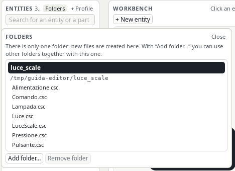
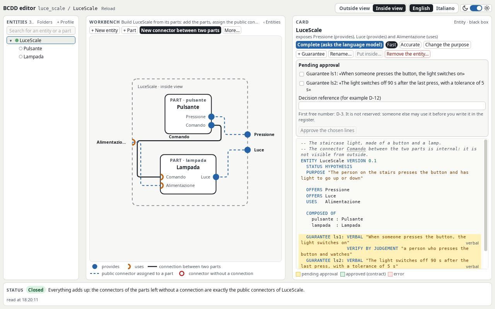
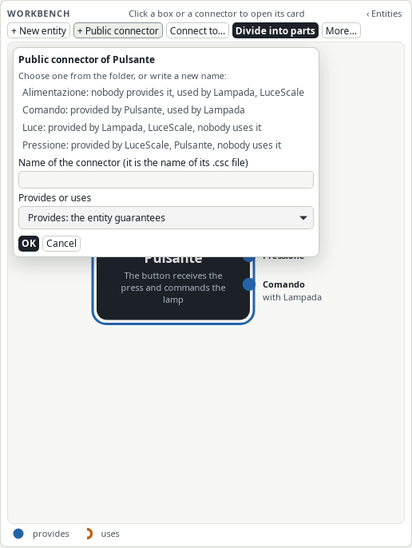
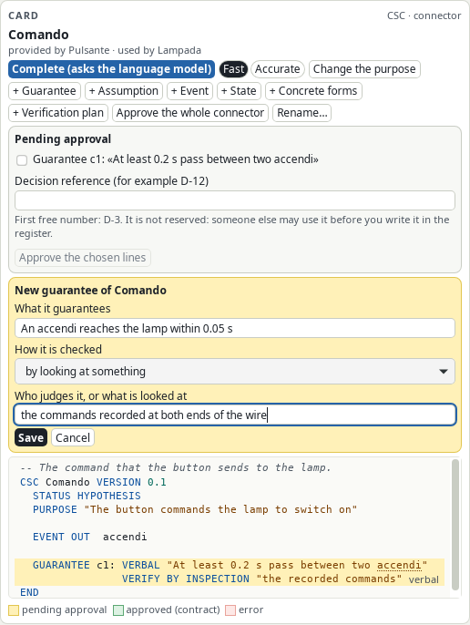
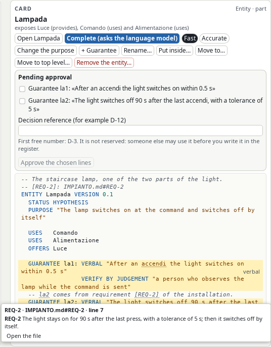
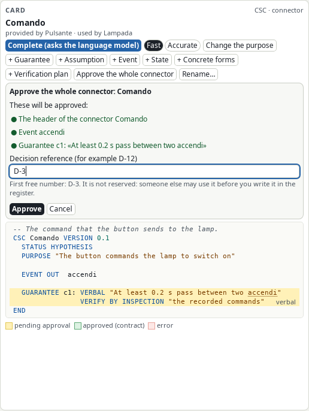
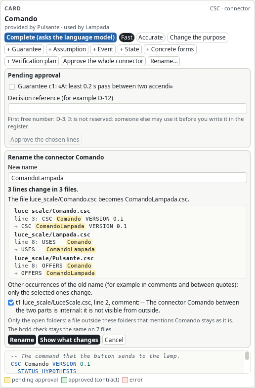

# The bcdd-editor guide

<!-- SPDX-License-Identifier: CC-BY-4.0 -->

`bcdd-editor` is the window for writing BCDD files without composing the lines of the grammar by hand: entities and
connectors are built on the Workbench (section 2), lines are composed with forms, and every write takes place through
`bcdd`, which checks the file immediately afterwards. This guide describes the use of the window; the language is in the manual.

The example in the screenshots is the staircase light of chapter 13 of the manual: the entities `LuceScale`, `Pulsante` and
`Lampada` and the connectors `Pressione`, `Luce`, `Comando` and `Alimentazione`, one per file, in the same folder.
Next to the `.csc` files there are a requirements document (`IMPIANTO.md`) and a decision register
(`WORK_REGISTER.md`), used in the sections on references and on approval.

*Copyright 2026 Noli Paolo. Document distributed under the Creative Commons Attribution 4.0 International licence ([CC BY 4.0](https://creativecommons.org/licenses/by/4.0/deed.en)).*

---

## 1. Start and folders

Installation is described on the “Download” page of the site. `bcdd-editor` looks for `bcdd` in the same folder as
the editor: the two executables must be kept together.

A working folder contains one `.csc` file for each entity and for each connector. The editor is started in one of
these ways:

```
bcdd-editor
bcdd-editor --dir FOLDER
bcdd-editor --dir FOLDER --dir OTHER LuceScale
bcdd-editor --lang it --dir FOLDER
```

- Without `--dir` the system folder chooser opens, “Choose one or more folders with the CSC files”, which starts from
  the last folder used and allows multiple selection. On Linux the path is typed by hand with Ctrl+L; on Windows
  network paths can also be typed in the address bar. “Cancel” closes the program without messages.
- `--dir` is repeated to open several folders together; the same folder twice is incorrect usage.
- The name of an entity at the end of the command, if present, opens that entity; without a name the Workbench shows
  the entities of the folder.
- `--lang it` or `--lang en` chooses the language (section 9).

The set of open folders is managed with the “Folders” button, at the top of the Entities area (section 2). The
pane that opens lists the `.csc` files of each folder; the highlighted folder is the one where new files are created, and it is changed by
clicking the folder or one of its files. “Add folder…” reopens the folder chooser; “Remove folder” removes the
highlighted folder from the list, without touching its files. At least one folder must remain. The editor remembers
the set and offers it at the next start.

If two folders contain a file with the same name, the one in the folder that comes first in the list is used, as
`bcdd` does when it looks for cited files; the other one is not opened and a warning bar reports it. A new file cannot have a name
already used in one of the folders.



## 2. The window

The window has a bar at the top and four areas.

- **Top bar**: the name of the program (“BCDD editor”), the path of the chosen entity (folder, entity and any
  parts; a click on an element other than the last one goes back there), the “Reload” button, the two views of the Workbench
  (“Outside view” and “Inside view”), the language choice (“English”, “Italiano”) and the theme switch.
- **Entities** (on the left): the entity tree. At the top appear, in alphabetical order, the entities that are not a
  part of another one. Under a composed entity appear its parts. The **part name** is the name under which a part appears
  in the entity that contains it, for example `pulsante` in the line `pulsante : Pulsante`; in the tree a part is
  shown as “part name — Entity”, for example “piano1 — Pulsante” for the line `piano1 : Pulsante`. If the two names
  differ only in capitalisation, the entity name alone appears, as for `Pulsante` and `Lampada` in the example.
  The search field (“Search for an entity or a part”) filters by entity or part name. The colour of the indicator next to the name shows the closure
  status (section 3). The “‹ Entities” button hides the tree and “› Entities” shows it again. The “+ Profile” button
  creates the file of an extension profile (chapter 27).
- **Workbench** (in the centre): the drawing of the chosen entity and the buttons that build it (section 3).
- **Card** (on the right): the text of the file of the chosen entity or connector, with the buttons that write
  it (section 4). Lines pending approval are yellow, approved lines green, errors red; the legend is at the bottom of
  the Card.
- **Status** (at the bottom): the closure status of the chosen entity, the problems found by `bcdd check` and the time
  of the last reading.

The dividers between the areas are dragged to change their width. A click on a box or on a connector of the Workbench
opens its Card.

The editor reads the `.csc` files again when the window becomes active, if they have changed on disk. “Reload” always reads
the folders again and rechecks; with an unsaved change it asks for confirmation (“Reload and discard the change” or
“Cancel and keep the change”).



## 3. Entities and connectors on the Workbench

The Workbench shows the chosen entity in two views. In the **outside view** the entity is a black box with its public
connectors (those that the entity shows to the outside): the filled dot marks a connector that the entity provides, the semicircle one that it uses. In the
**inside view** the parts appear, with the solid lines of the connections between two parts and the dashed lines of
the public connectors assigned to a part. A connector without a connection is a red circle. The meaning of entity,
part and closure is in chapters 12 and 13.

Each Workbench button, except “Divide into parts”, writes through `bcdd save` (or creates a connector with
`bcdd new`) and changes only the lines needed:

| Button | What it asks for | What it writes |
|---|---|---|
| “+ New entity” | name and purpose in one sentence | the file `NAME.csc` with `ENTITY`, `PURPOSE` and `END` |
| “+ Public connector” | the connector, chosen from the list of the folder or with a new name, and the side (“Provides or uses”) | the `OFFERS` or `USES` line in the entity; the file of the connector, if missing |
| “Connect to…” (outside view) | the other entity and the connector | the missing lines: an `OFFERS` line in one entity and a `USES` line in the other |
| “Divide into parts” | nothing | opens the inside view |
| “+ Part” (inside view) | name of the part and entity, existing or new | `COMPOSED OF`, if missing, and the line `name : Entity` |
| “Assign a public connector to a part” | the connector and the part | in the file of the entity of the part, the same `OFFERS` or `USES` line as the entity |
| “New connector between two parts” | name, who provides and who uses | `OFFERS` in one part and `USES` in the other; the file of the connector, if missing |

In the list of “+ Public connector” each connector of the folder shows who provides it and who uses it; when a
connector is chosen, the form proposes the missing side.

A click on a line, on a part or on a connector on the border of the entity selects it and adds to the Workbench actions the
button that removes it (“Disconnect …”, “Remove the part …”, “Remove …”); when the Workbench bar has no room, the
button is in the “More…” menu. These actions ask for confirmation with a sentence and remove only lines: the file of
the connector and that of the entity of the part remain. “Undo the last action” rewrites the files as they were
before the last action, while the window stays open; if a file has meanwhile changed outside the editor, it does not write and says so.

Parts can also be managed from the tree: dragging an entity onto another one puts it inside as a part; in the Card of
an entity there are “Put inside…”, “Move to…” and “Move to top level…” (the last one brings it back to the top level).

Three actions remove a file, always with confirmation and through `bcdd save`, which leaves the `.prima` file next to
it (section 9):

- “Remove the entity…”, in the Card of an entity: it lists the parts in which the entity is used, removes them together
  with the file of the entity and leaves the connectors;
- “Remove the connector…”, in the Card of a connector that no entity provides or uses (in the tree, in the group
  “Unused connectors”): it removes the file of the connector;
- “Remove the profile…”, in the Card of a profile that no file imports: it removes the file of the profile.

A file with approved lines cannot be removed, and a part cannot be removed from an entity with approved lines. The
three actions are part of “Undo the last action”.

The status of an entity, at the bottom and in the indicator of the tree, is one of these: “Without parts”, “Closed” (the
connectors of the parts left without a connection are exactly the public connectors), “Not closed” (with the list of
what is missing), “Missing part” (a part cannot be found in the open folders).



## 4. Writing in the Card

In the Card the grammar is not written: the fields of a form are filled in and the editor composes the lines. The
buttons are:

- “Change the purpose” and “+ Guarantee”, for entities and connectors;
- “+ Assumption”, “+ Event” and “+ State”, only for connectors (assumptions, events and states are not written in an
  entity);
- “+ Concrete forms” and “+ Verification plan”, only for connectors (chapters 25 and 26).

The form of a guarantee asks for “What it guarantees”, “How it is checked” (“by someone's judgement”, “by looking at
something” or “written as a formula”) and “Who judges it, or what is looked at”. The identifier is chosen by the
editor, with the prefix of the guarantees already present and the first free number (for example, `c2` comes after
`c1`). Each field reports what the grammar does not allow, for example quotation marks inside a sentence, and as long
as a field is not valid “Save” does not write.

A click on a yellow line opens its form already filled in, with “Save”, “Remove” and “Cancel”; for guarantees and
assumptions also “Approve” (section 7) and “Rename the identifier…” (section 8). The lines that no form handles (the
header, `COMPOSED OF`, formulas, comments, unrecognised lines) open a text box with the text as it is in the file:
“Write” replaces only those lines; if the text box is empty, the lines are removed. The `OFFERS` and `USES` lines are changed from the Workbench. In the
text box a text with errors is written anyway, and the lines turn red with the message of `bcdd` (section 5).

An approved line opens neither a form nor a text box: it is a contract. To change it, a new version is prepared with
“New version” (section 7).

“Complete (asks the language model)” asks a language model what the chosen entity or connector is missing,
through `bcdd refine` (chapter 8). “Fast” and “Accurate” choose the model. The questions are answered, the proposals are accepted or
discarded (“Accept”, “Discard”) and only “Write the accepted lines” writes: the new lines remain pending approval.
A session of Complete, from the first question to the writing of the lines, is called a **round**. Complete does not
start if the file has errors, and it requires Claude Code, as described on the “Download” page.



## 5. The bcdd check

The check has no button: the editor runs `bcdd check --json` on every `.csc` file of the open folders, on opening,
after every write and at every “Reload”. It passes all the folders to `bcdd`, in the order of the “Folders” list.
The result appears in three places:

- in the Card, the line that contains an error is red and the message of `bcdd` is under the line;
- in the Status area, the list of the problems of the entity or of the connector;
- in the tree, the colour of the indicator.

The messages are those of `bcdd`, without the error codes. An error does not prevent writing or continuing the work;
it prevents approval (section 7) and the use of “Complete”. “Closed” and the absence of errors hold only for what `bcdd check` checks: when the
file contains formulas on scenarios (`SCENARIO`), which `bcdd check` does not evaluate, the status says “No errors; formulas not
evaluated” and the section “Checks that bcdd does not execute” lists the lines concerned. The checks of `bcdd check` are
listed in appendix B.

To see the same report in a terminal, the command is run from the folder of the file:

```
bcdd check --dir . LuceScale.csc
```

The image shows the staircase light after “Disconnect Alimentazione from lampada” (a click on the dashed line of
`Alimentazione`, then the item in the “More…” menu of the Workbench): `LuceScale` declares that it
uses `Alimentazione`, but none of its parts uses it any more. The entity is “Not closed”, the connector, still selected, is a red circle, and
“Undo the last action” restores the file.


## 6. References

In the free texts of the Card (the strings of `PURPOSE`, `VERBAL` and `VERIFY` and the `--` comments) the editor
recognises three kinds of reference. A reference is underlined with a dotted line: when the pointer hovers over it, a
preview shows its content, and a click keeps it open.

**Internal references.** A word equal to the name of a guarantee, an assumption, a connector, an entity, a type or an
event declared in the open folders is a reference. The preview shows the declaration; a click goes to its line.
The comparison is exact on the whole word, capitalisation included: in the comment of `LuceScale` the word `Comando`
leads to the connector `Comando`.

**References to external documents.** A label in square brackets, defined in a comment of the same file, leads to a
Markdown document or to a web address:

```
-- [REQ-2]: IMPIANTO.md#REQ-2
...
  -- la2 comes from requirement [REQ-2] of the installation.
```

- The definition occupies a comment line on its own and holds for the whole `.csc` file. The destination is a path
  relative to the folder of the file, with `/` as separator, to a `.md` file, with or without `#ID`; or an `http://` or
  `https://` address.
- The target point `#ID` is found through an anchor `<a id="ID"></a>` in the document or, when there are no anchors,
  through the block that begins with `**ID**`. The preview shows that block (at most 40 lines), with the “Open the
  file” button, which opens the file with the default application of the system; for a web address, “Open in the
  browser”.
- The inline form `[testo](IMPIANTO.md#REQ-2)` is also allowed.
- An unresolved reference (missing file, missing or repeated target point, invalid destination, label without a definition
  or defined twice, decision missing from the register) is underlined with a wavy line and
  the preview gives the reason. The counter “unresolved references: N”, under the name in the Card, leads to the first
  one. An unresolved reference blocks nothing.

The Markdown documents are read when the folders are opened and at every “Reload”, read-only: after a change to
`IMPIANTO.md` a “Reload” is needed.

**Decisions.** `D-` followed by a number (for example `D-1` in `STATUS RATIFIED BY D-1`) is a reference to the
decision register, and the preview shows its row. The register is the file given by the definition
`-- [Registro delle decisioni]: percorso.md`, or, without a definition, the first `WORK_REGISTER.md` found starting
from the folder of the file and going up towards the root. A decision row begins with `| D-` and a number:

```
| D-1 | 2026-11-28 | CSC Pressione 0.1 approved: whoever presses holds the button down for at least a tenth of a second |
```



## 7. Approving

Approving turns a line that is pending approval into a contract, with a decision reference written by hand
(chapter 7).
The approval is performed by `bcdd ratify`; the editor prepares the command and shows the outcome.

- In the Card of an entity or of a connector with yellow lines the list “Pending approval” appears, with one checkbox
  per line, and the “Approve the chosen lines” button.
- The form of a guarantee or of an assumption pending approval has the “Approve” button, for that line alone.
- In the Card of a connector, “Approve the whole connector” first shows the list of the lines that become a contract
  (“These will be approved:”) and of those that remain pending approval one by one, then asks for the reference. In an
  entity the guarantees are approved, not the header.

The field “Decision reference (for example D-12)” accepts only `D-` followed by digits; without a valid value the
button stays disabled. Below the field the editor shows the first free number of the register of the file (section 6), for
example “First free number: D-3”, without writing it in the field: the number is not reserved, and the decision must be written
in the register by the approver. If the number written is already in the register, the editor shows its row, for
information.

The approval is not performed if the file has errors or unrecognised lines: the editor says so and lists the problems.
Several lines approved together count as a single action for “Undo the last action”.

An approved line is not changed. “New version”, in the Card of an entity or of a connector with approved lines,
asks for “What changes” (one sentence), the “Version number” (proposed with the last digit increased) and which
approved lines return to pending approval. “Prepare the version” writes the `-- VERSION` comment with the number and
the sentence above the header, puts the new number in the header and sets back to `STATUS HYPOTHESIS` the header of a
connector and the chosen lines. These lines are changed and approved again like the others (chapter 10).



## 8. Renaming

A name is changed in all the files of the open folders with a single command, `bcdd rename`, after a preview. There
are three buttons:

- “Rename…”, in the Card of a connector or of an entity: it changes the name of the connector or of the entity and
  that of its file;
- “Rename the part…”, on the Workbench: it changes the name of the part chosen in the inside view;
- “Rename the identifier…”, in the form of a guarantee or of an assumption and in the text box of a `GUARANTEE`,
  `ASSUME` or `SCENARIO` line: it changes the identifier.

The form has the field “New name”. “Show what changes” lists the renamed files and the lines before and after; the
texts that contain the old name (comments and strings) have a checkbox, preset according to the proposal of `bcdd`,
to choose whether to change them. Approved lines stay unchanged (“stays …: approved line”), and the preview confirms that the
`bcdd` check stays the same. “Rename” writes all the changes or none; files outside the open folders do not change.

If the name appears in approved lines, the rename is refused: the form lists the approved lines that block it and, when a
connector or an entity is renamed and those lines are all in its file, offers “New version…”. A rename is not part of “Undo the last action”: to go
back to the previous name, the element is renamed again, as the message shown after the rename indicates. If a rename stops halfway (for
example because the program was interrupted), a bar reports it on opening and blocks every write until “Recover” is
chosen, which puts the files back as they were. The complete rules are in section 15 of the grammar.



## 9. Language, theme and files

**Language.** The “English” and “Italiano” buttons of the top bar change the language of the interface and of the
messages of `bcdd`; the choice is remembered. At start-up the following apply, in order: `--lang`, the remembered
choice, the environment variable `BCDD_LANG`, the language of the system, English. The language cannot be changed while
there is an unsaved change or a round of Complete open.

**Theme.** The “Switch light/dark theme” switch, next to the language, changes from the dark theme, which is the
default, to the light theme and back; the choice is remembered.

**What the editor writes.** The `.csc` files are written only through `bcdd` (`save`, `new`, `ratify`, `rename`,
`refine`). Next to the files the following may appear:

| File | Who writes it and why |
|---|---|
| `NAME.csc.prima` | `bcdd save`: the text as it was before the last write (or the removed file), used by “Undo the last action” |
| `NAME.csc.giro` | `bcdd refine`: a round of Complete left open; on reopening the entity or the connector the editor offers to resume it or to close it |
| `NAME.csc.dialogo` | `bcdd refine`: questions and answers of Complete |
| `.bcdd-rinomina` | `bcdd rename`: the journal of a rename in progress; it remains only if the rename stopped halfway |

The editor creates no position files: the drawing of the Workbench is recalculated every time from the text. The
Markdown documents and the decision register are only read.

**Configuration.** The editor remembers the language and the folders in the files `lingua` and `cartella` of the
`bcdd-editor` folder, in `$XDG_CONFIG_HOME` or `~/.config` on Linux and in `%APPDATA%` on Windows. The theme is
remembered by the window itself, not in a configuration file.

**Network.** The editor does not use the network. Only “Complete”, through `bcdd refine` and Claude Code, sends data
to the language model; the data sent is described on the “About this site” page.
