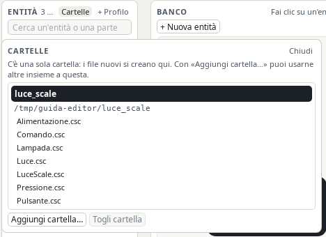
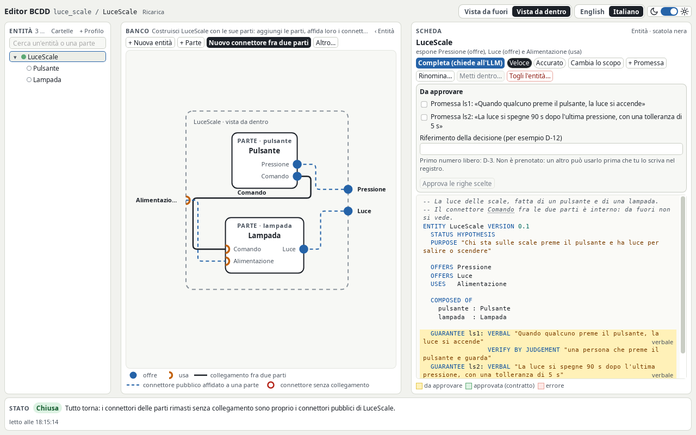
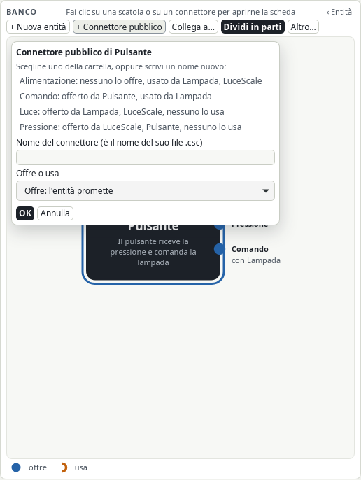
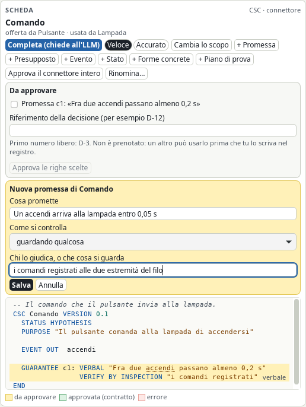
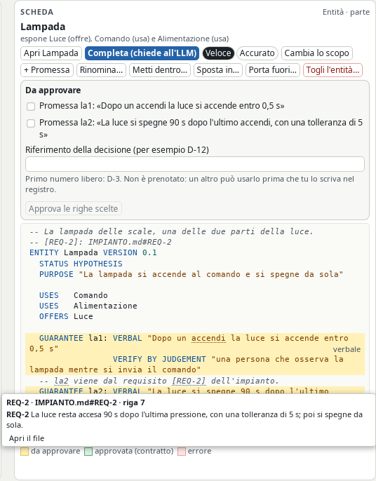
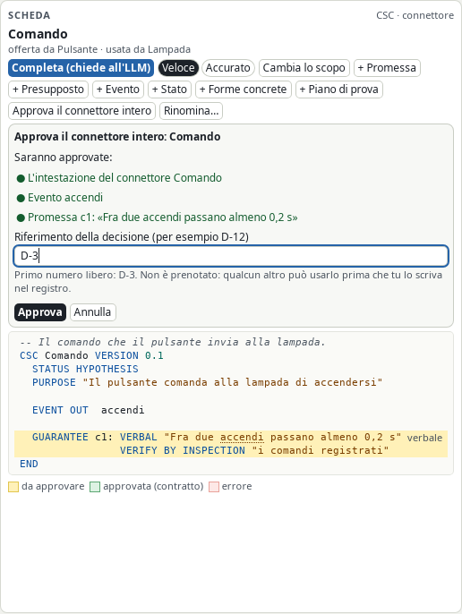
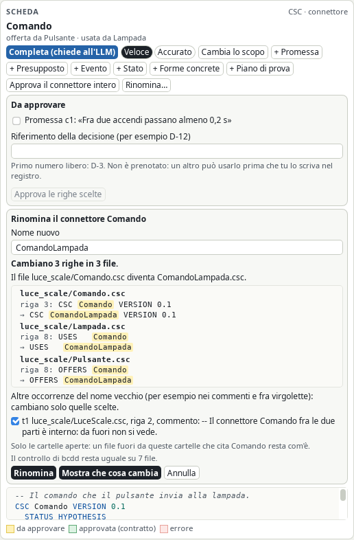

# Guida di bcdd-editor

<!-- SPDX-License-Identifier: CC-BY-4.0 -->

`bcdd-editor` è la finestra per scrivere file BCDD senza comporre a mano le righe della grammatica: le entità e i
connettori si costruiscono sul Banco (sezione 2), le righe si compongono con moduli, e ogni scrittura avviene tramite
`bcdd`, che controlla il file subito dopo. Questa guida descrive l'uso della finestra; il linguaggio è nel manuale.

L'esempio delle schermate è la luce delle scale del capitolo 13 del manuale: le entità `LuceScale`, `Pulsante` e `Lampada` e i
connettori `Pressione`, `Luce`, `Comando` e `Alimentazione`, uno per file, nella stessa cartella. Accanto ai file
`.csc` stanno un documento di requisiti (`IMPIANTO.md`) e un registro delle decisioni (`WORK_REGISTER.md`), usati nelle
sezioni sui riferimenti e sull'approvazione.

*Copyright 2026 Noli Paolo. Documento distribuito con licenza Creative Commons Attribuzione 4.0 Internazionale ([CC BY 4.0](https://creativecommons.org/licenses/by/4.0/deed.it)).*

---

## 1. Avvio e cartelle

L'installazione è descritta nella pagina «Scaricare» del sito. `bcdd-editor` cerca `bcdd` nella stessa cartella
dell'editor: i due eseguibili vanno tenuti insieme.

Una cartella di lavoro contiene un file `.csc` per ogni entità e per ogni connettore. L'editor si avvia in uno di
questi modi:

```
bcdd-editor
bcdd-editor --dir CARTELLA
bcdd-editor --dir CARTELLA --dir ALTRA LuceScale
bcdd-editor --lang it --dir CARTELLA
```

- Senza `--dir` si apre la finestra di scelta del sistema, «Scegli una o più cartelle con i file CSC», che parte
  dall'ultima cartella usata e ammette la scelta multipla. Su Linux il percorso si scrive a mano con Ctrl+L; su
  Windows si possono scrivere anche percorsi di rete nella barra dell'indirizzo. «Annulla» chiude il programma senza
  messaggi.
- `--dir` si ripete per aprire più cartelle insieme; la stessa cartella due volte è un errore d'uso.
- L'eventuale nome di un'entità in fondo al comando apre quell'entità; senza nome il Banco mostra le entità della
  cartella.
- `--lang it` o `--lang en` sceglie la lingua (sezione 9).

L'insieme delle cartelle aperte si gestisce con il bottone «Cartelle», in alto nella zona Entità (sezione 2). Il
riquadro che si apre elenca i file `.csc` di ogni cartella; la cartella evidenziata è quella in cui nascono i file nuovi, e si cambia con un
clic sulla cartella o su uno dei suoi file. «Aggiungi cartella…» riapre la finestra di scelta; «Togli cartella» toglie
dall'elenco la cartella evidenziata, senza toccarne i file. Deve restare almeno una cartella. L'editor ricorda
l'insieme e lo propone all'avvio successivo.

Se due cartelle contengono un file con lo stesso nome, si usa quello della cartella che viene prima nell'elenco, come
fa `bcdd` quando cerca i file citati; l'altro non si apre e una barra di avviso lo segnala. Un file nuovo non può avere un nome
già usato in una delle cartelle.



## 2. La finestra

La finestra ha una barra in alto e quattro zone.

- **Barra in alto**: il nome del programma («Editor BCDD»), il percorso dell'entità scelta (cartella, entità ed
  eventuali parti; un clic su un elemento che non sia l'ultimo riporta lì), il bottone «Ricarica», le due viste del Banco
  («Vista da fuori» e «Vista da dentro»), la scelta della lingua («English», «Italiano») e l'interruttore del tema.
- **Entità** (a sinistra): l'albero delle entità. In cima compaiono, in ordine alfabetico, le entità che non sono
  parte di un'altra. Sotto un'entità composta compaiono le sue parti. Il **nome della parte** è il nome con cui una parte
  compare nell'entità che la contiene, per esempio `pulsante` nella riga `pulsante : Pulsante`; nell'albero una parte
  si mostra come «nome della parte — Entità», per esempio «piano1 — Pulsante» per la riga `piano1 : Pulsante`. Se i due nomi
  differiscono solo per le maiuscole, compare solo il nome dell'entità, come per `Pulsante` e `Lampada` nell'esempio.
  Il campo di ricerca («Cerca un'entità o una parte») filtra per nome di entità o di parte. Il colore dell'indicatore accanto al nome mostra lo stato
  di chiusura (sezione 3). Il bottone «‹ Entità» nasconde l'albero e «› Entità» lo riapre. Il bottone «+ Profilo»
  crea il file di un profilo di estensioni (capitolo 27).
- **Banco** (al centro): il disegno dell'entità scelta e i bottoni che la costruiscono (sezione 3).
- **Scheda** (a destra): il testo del file dell'entità o del connettore scelto, con i bottoni che lo scrivono
  (sezione 4). Le righe da approvare sono gialle, le righe approvate verdi, gli errori rossi; la legenda è in fondo
  alla Scheda.
- **Stato** (in basso): lo stato di chiusura dell'entità scelta, i problemi trovati da `bcdd check` e l'ora
  dell'ultima lettura.

I divisori fra le zone si trascinano per cambiarne la larghezza. Un clic su una scatola o su un connettore del Banco
apre la sua Scheda.

L'editor rilegge i file `.csc` quando la finestra torna attiva, se sono cambiati sul disco. «Ricarica» rilegge sempre le
cartelle e rifà il controllo; con una modifica non salvata chiede conferma («Ricarica e perdi la modifica» oppure
«Annulla e tieni la modifica»).



## 3. Entità e connettori sul Banco

Il Banco mostra l'entità scelta in due viste. Nella **vista da fuori** l'entità è una scatola nera con i suoi
connettori pubblici (quelli che l'entità mostra all'esterno): la pallina piena indica un connettore che l'entità offre, il semicerchio uno che usa. Nella
**vista da dentro** compaiono le parti, le linee piene dei collegamenti fra due parti e le linee tratteggiate dei
connettori pubblici affidati a una parte. Un connettore senza collegamento è un cerchio rosso. Il significato di
entità, parte e chiusura è nei capitoli 12 e 13.

Ogni bottone del Banco, tranne «Dividi in parti», scrive tramite `bcdd save` (o crea un connettore con `bcdd new`) e
cambia solo le righe necessarie:

| Bottone | Che cosa chiede | Che cosa scrive |
|---|---|---|
| «+ Nuova entità» | nome e scopo in una frase | il file `NOME.csc` con `ENTITY`, `PURPOSE` e `END` |
| «+ Connettore pubblico» | il connettore, scelto dall'elenco della cartella o con un nome nuovo, e il lato («Offre o usa») | la riga `OFFERS` o `USES` nell'entità; il file del connettore, se manca |
| «Collega a…» (vista da fuori) | l'altra entità e il connettore | le righe mancanti: una riga `OFFERS` in un'entità e una riga `USES` nell'altra |
| «Dividi in parti» | niente | apre la vista da dentro |
| «+ Parte» (vista da dentro) | nome della parte ed entità, esistente o nuova | `COMPOSED OF`, se manca, e la riga `nome : Entità` |
| «Affida un connettore pubblico a una parte» | il connettore e la parte | nel file dell'entità della parte, la stessa riga `OFFERS` o `USES` dell'entità |
| «Nuovo connettore fra due parti» | nome, chi offre e chi usa | `OFFERS` in una parte e `USES` nell'altra; il file del connettore, se manca |

Nell'elenco di «+ Connettore pubblico» ogni connettore della cartella riporta chi lo offre e chi lo usa; scegliendo
un connettore, il modulo propone il lato mancante.

Un clic su una linea, su una parte o su un connettore sul bordo dell'entità lo seleziona e aggiunge fra le azioni del Banco il
bottone che lo toglie («Scollega …», «Togli la parte …», «Togli …»); quando la barra del Banco non ha spazio, il bottone
sta nel menù «Altro…». Queste azioni chiedono conferma con una frase e tolgono solo righe: il file del connettore e
quello dell'entità della parte restano. «Torna indietro di un'azione» riscrive i file com'erano prima dell'ultima
azione, finché la finestra resta aperta; se nel frattempo un file è cambiato fuori dall'editor, non scrive e lo dice.

Le parti si gestiscono anche dall'albero: trascinare un'entità su un'altra la mette dentro come parte; nella Scheda di
un'entità ci sono «Metti dentro…», «Sposta in…» e «Porta fuori…» (quest'ultimo la riporta al primo livello).

Tre azioni tolgono un file, sempre con conferma e tramite `bcdd save`, che lascia accanto il file `.prima` (sezione 9):

- «Togli l'entità…», nella Scheda di un'entità: elenca le parti in cui l'entità è usata, le toglie insieme al file
  dell'entità e lascia i connettori;
- «Togli il connettore…», nella Scheda di un connettore che nessuna entità offre né usa (nell'albero, nel gruppo
  «Connettori non usati»): toglie il file del connettore;
- «Togli il profilo…», nella Scheda di un profilo che nessun file importa: toglie il file del profilo.

Un file con righe approvate non si toglie, e una parte non si toglie da un'entità con righe approvate. Le tre azioni
rientrano in «Torna indietro di un'azione».

Lo stato di un'entità, in basso e nell'indicatore dell'albero, è uno di questi: «Senza parti», «Chiusa» (i connettori
delle parti rimasti senza collegamento sono esattamente i connettori pubblici), «Non chiusa» (con l'elenco di ciò che
manca), «Parte mancante» (una parte non si trova nelle cartelle aperte).



## 4. Scrivere nella Scheda

Nella Scheda non si scrive la grammatica: si riempiono i campi di un modulo e l'editor compone le righe. I bottoni
sono:

- «Cambia lo scopo» e «+ Promessa», per entità e connettori;
- «+ Presupposto», «+ Evento» e «+ Stato», solo per i connettori (in un'entità presupposti, eventi e stati non si
  scrivono);
- «+ Forme concrete» e «+ Piano di prova», solo per i connettori (capitoli 25 e 26).

Il modulo di una promessa chiede «Cosa promette», «Come si controlla» («a giudizio di qualcuno», «guardando qualcosa»
oppure «scritta come formula») e «Chi lo giudica, o che cosa si guarda». L'identificativo lo sceglie l'editor, con il
prefisso delle promesse già presenti e il primo numero libero (per esempio, dopo `c1` viene `c2`). Ogni campo segnala
ciò che la grammatica non ammette, per esempio le virgolette dentro una frase, e finché un campo non è valido
«Salva» non scrive.

Un clic su una riga gialla apre il suo modulo già compilato, con «Salva», «Togli» e «Annulla»; per promesse e
presupposti anche «Approva» (sezione 7) e «Rinomina l'identificativo…» (sezione 8). Le righe che nessun
modulo conosce (l'intestazione, `COMPOSED OF`, le formule, i commenti, le righe non riconosciute) aprono una casella
con il testo com'è nel file: «Scrivi» sostituisce solo quelle righe; se la casella è vuota, le righe vengono tolte. Le righe `OFFERS` e
`USES` si cambiano dal Banco. Nella casella un testo con errori si scrive comunque, e le righe diventano rosse con il messaggio di
`bcdd` (sezione 5).

Una riga approvata non apre né modulo né casella: fa parte del contratto. Per cambiarla si prepara una versione nuova con
«Nuova versione» (sezione 7).

«Completa (chiede all'LLM)» chiede a un modello linguistico che cosa manca all'entità o al connettore scelto,
tramite `bcdd refine` (capitolo 8). «Veloce» e «Accurato» scelgono il modello. Si risponde alle domande, si accettano o si scartano le
proposte («Accetta», «Scarta») e solo «Scrivi le righe accettate» scrive: le righe nuove restano da approvare.
Una sessione di Completa, dalla prima domanda alla scrittura delle righe, si chiama **giro**. Completa non parte se
il file ha errori, e richiede Claude Code, come descritto nella pagina «Scaricare».



## 5. Il controllo di bcdd

Il controllo non ha un bottone: l'editor esegue `bcdd check --json` su ogni file `.csc` delle cartelle aperte,
all'apertura, dopo ogni scrittura e a ogni «Ricarica». A `bcdd` passa tutte le cartelle, nell'ordine dell'elenco
«Cartelle». Il risultato compare in tre punti:

- nella Scheda, la riga che contiene un errore è rossa e il messaggio di `bcdd` sta sotto la riga;
- nella zona Stato, l'elenco dei problemi dell'entità o del connettore;
- nell'albero, il colore dell'indicatore.

I messaggi sono quelli di `bcdd`, senza i codici d'errore. Un errore non impedisce di scrivere né di continuare il
lavoro; impedisce l'approvazione (sezione 7) e l'uso di «Completa». «Chiusa» e l'assenza di errori valgono solo per ciò che `bcdd check`
controlla: quando il file contiene formule sulle storie (`SCENARIO`), che `bcdd check` non valuta, lo stato dice «Nessun errore;
formule non valutate» e il riquadro «Controlli che bcdd non esegue» elenca le righe interessate. I controlli di
`bcdd check` sono elencati nell'appendice B.

Per vedere lo stesso rapporto in un terminale si lancia il comando dalla cartella del file:

```
bcdd check --dir . LuceScale.csc
```

L'immagine mostra la luce delle scale dopo «Scollega Alimentazione da lampada» (clic sulla linea tratteggiata di
`Alimentazione`, poi la voce nel menù «Altro…» del Banco): `LuceScale` dichiara di usare
`Alimentazione`, ma nessuna sua parte la usa più. L'entità è «Non chiusa», il connettore, ancora selezionato, è un cerchio rosso, e
«Torna indietro di un'azione» ripristina il file.


## 6. Riferimenti

Nei testi liberi della Scheda (le stringhe di `PURPOSE`, `VERBAL` e `VERIFY` e i commenti `--`) l'editor riconosce tre
tipi di riferimento. Un riferimento è sottolineato a puntini: al passaggio del mouse un'anteprima ne mostra il
contenuto, e un clic la tiene aperta.

**Riferimenti interni.** Una parola uguale al nome di una promessa, di un presupposto, di un connettore, di
un'entità, di un tipo o di un evento dichiarati nelle cartelle aperte è un riferimento. L'anteprima mostra la
dichiarazione; un clic porta alla sua riga. Il confronto è esatto sulla parola intera, maiuscole comprese: nel
commento di `LuceScale` la parola `Comando` porta al connettore `Comando`.

**Riferimenti a documenti esterni.** Un'etichetta fra parentesi quadre, definita in un commento dello stesso file,
porta a un documento Markdown o a un indirizzo web:

```
-- [REQ-2]: IMPIANTO.md#REQ-2
...
  -- la2 viene dal requisito [REQ-2] dell'impianto.
```

- La definizione occupa da sola una riga di commento e vale per tutto il file `.csc`. La destinazione è un percorso
  relativo alla cartella del file, con `/` come separatore, verso un file `.md`, con o senza `#ID`; oppure un indirizzo
  `http://` o `https://`.
- Il punto di arrivo `#ID` si trova con un'ancora `<a id="ID"></a>` nel documento o, in assenza di ancore, con il
  blocco che comincia con `**ID**`. L'anteprima mostra quel blocco (al più 40 righe), con il bottone «Apri il file»,
  che apre il file con l'applicazione predefinita del sistema; per un indirizzo web, «Apri nel browser».
- È ammessa anche la forma in linea `[testo](IMPIANTO.md#REQ-2)`.
- Un riferimento non risolto (file assente, punto di arrivo assente o ripetuto, destinazione non valida, etichetta
  senza definizione o definita due volte, decisione assente dal registro) è sottolineato con
  una linea ondulata e l'anteprima ne dice il motivo. Il contatore «riferimenti non risolti: N», sotto il nome nella
  Scheda, porta al primo. Un riferimento non risolto non blocca nulla.

I documenti Markdown si leggono all'apertura delle cartelle e a ogni «Ricarica», in sola lettura: dopo una modifica di
`IMPIANTO.md` serve «Ricarica».

**Decisioni.** `D-` seguito da un numero (per esempio `D-1` in `STATUS RATIFIED BY D-1`) è un riferimento al registro
delle decisioni, e l'anteprima mostra la sua riga. Il registro è il file indicato dalla definizione
`-- [Registro delle decisioni]: percorso.md`, oppure, senza definizione, il primo `WORK_REGISTER.md` che si incontra
partendo dalla cartella del file e salendo verso la radice. Una riga di decisione comincia con `| D-` e un numero:

```
| D-1 | 2026-11-28 | Approvata la CSC Pressione 0.1: chi preme tiene premuto almeno un decimo di secondo |
```



## 7. Approvare

Approvare rende contratto una riga da approvare, con il riferimento a una decisione, che si scrive a mano (capitolo 7).
L'approvazione è eseguita da `bcdd ratify`; l'editor prepara il comando e mostra l'esito.

- Nella Scheda di un'entità o di un connettore con righe gialle compare l'elenco «Da approvare», con una casella di
  controllo per riga, e il bottone «Approva le righe scelte».
- Il modulo di una promessa o di un presupposto da approvare ha il bottone «Approva», per quella sola riga.
- Nella Scheda di un connettore, «Approva il connettore intero» mostra prima l'elenco delle righe che diventano
  contratto («Saranno approvate:») e di quelle che restano da approvare una per una, poi chiede il riferimento. In
  un'entità si approvano le promesse, non l'intestazione.

Il campo «Riferimento della decisione (per esempio D-12)» accetta solo `D-` seguito da cifre; senza un valore valido
il bottone resta disattivato. Sotto il campo l'editor mostra il primo numero libero del registro del file (sezione 6), per
esempio «Primo numero libero: D-3», senza scriverlo nel campo: il numero non è prenotato, e la decisione va scritta nel registro
da chi approva. Se il numero scritto è già nel registro, l'editor ne mostra la riga, a titolo informativo.

L'approvazione non viene eseguita se il file ha errori o righe non riconosciute: l'editor lo dice ed elenca i problemi. Più
righe approvate insieme contano come una sola azione per «Torna indietro di un'azione».

Una riga approvata non si cambia. «Nuova versione», nella Scheda di un'entità o di un connettore con righe approvate,
chiede «Che cosa cambia» (una frase), il «Numero della versione» (proposto con l'ultima cifra aumentata) e quali righe
approvate tornano da approvare. «Prepara la versione» scrive sopra l'intestazione il commento `-- VERSION` con il
numero e la frase, mette il numero nuovo nell'intestazione e riporta a `STATUS HYPOTHESIS` l'intestazione di un
connettore e le righe scelte. Queste righe si cambiano e si approvano di nuovo come le altre (capitolo 10).



## 8. Rinominare

Un nome si cambia in tutti i file delle cartelle aperte con un solo comando, `bcdd rename`, dopo un'anteprima. I
bottoni sono tre:

- «Rinomina…», nella Scheda di un connettore o di un'entità: cambia il nome del connettore o dell'entità e quello
  del suo file;
- «Rinomina la parte…», sul Banco: cambia il nome della parte scelta nella vista da dentro;
- «Rinomina l'identificativo…», nel modulo di una promessa o di un presupposto e nella casella di una riga
  `GUARANTEE`, `ASSUME` o `SCENARIO`: cambia l'identificativo.

Il modulo ha il campo «Nome nuovo». «Mostra che cosa cambia» elenca i file rinominati e le righe prima e dopo; i
testi che contengono il nome vecchio (commenti e stringhe) hanno una casella di controllo, preimpostata secondo la
proposta di `bcdd`, per scegliere se cambiarli. Le righe approvate restano invariate («resta …: riga approvata»), e l'anteprima conferma che
il controllo di `bcdd` resta uguale. «Rinomina» scrive tutte le modifiche oppure nessuna; i file fuori dalle cartelle aperte non
cambiano.

Se il nome compare in righe approvate, la rinomina è rifiutata: il modulo elenca le righe approvate che la bloccano e, quando si rinomina un
connettore o un'entità e quelle righe stanno tutte nel suo file, offre «Nuova versione…». Una rinomina non rientra in
«Torna indietro di un'azione»: per tornare al nome di prima si rinomina di nuovo, come indica il messaggio mostrato a rinomina eseguita.
Se una rinomina si ferma a metà (per esempio per un'interruzione del programma), una barra lo segnala all'apertura e
blocca ogni scrittura finché non si sceglie «Ripristina», che rimette i file com'erano. Le regole complete sono nella
sezione 15 della grammatica.



## 9. Lingua, tema e file

**Lingua.** I bottoni «English» e «Italiano» della barra in alto cambiano la lingua dell'interfaccia e dei messaggi di
`bcdd`; la scelta viene ricordata. All'avvio vale, nell'ordine: `--lang`, la scelta ricordata, la variabile
d'ambiente `BCDD_LANG`, la lingua del sistema, l'inglese. La lingua non si può cambiare mentre c'è una modifica non
salvata o un giro di Completa aperto.

**Tema.** L'interruttore «Cambia tema chiaro/scuro», accanto alla lingua, passa dal tema scuro, che è il predefinito,
al tema chiaro e viceversa; la scelta viene ricordata.

**Che cosa scrive l'editor.** I file `.csc` sono scritti solo attraverso `bcdd` (`save`, `new`, `ratify`, `rename`,
`refine`). Accanto ai file possono comparire:

| File | Chi lo scrive e perché |
|---|---|
| `NOME.csc.prima` | `bcdd save`: il testo com'era prima dell'ultima scrittura (o il file tolto), usato da «Torna indietro di un'azione» |
| `NOME.csc.giro` | `bcdd refine`: un giro di Completa rimasto aperto; alla riapertura dell'entità o del connettore l'editor propone di riprenderlo o di chiuderlo |
| `NOME.csc.dialogo` | `bcdd refine`: domande e risposte di Completa |
| `.bcdd-rinomina` | `bcdd rename`: il giornale di una rinomina in corso; resta solo se la rinomina si è fermata a metà |

L'editor non crea file di posizioni: il disegno del Banco si ricalcola ogni volta dal testo. I documenti Markdown e il
registro delle decisioni si leggono soltanto.

**Configurazione.** L'editor ricorda la lingua e le cartelle nei file `lingua` e `cartella` della cartella
`bcdd-editor`, in `$XDG_CONFIG_HOME` o `~/.config` su Linux e in `%APPDATA%` su Windows. Il tema è ricordato dalla
finestra stessa, non in un file di configurazione.

**Rete.** L'editor non usa la rete. Solo «Completa», tramite `bcdd refine` e Claude Code, invia dati al modello
linguistico; i dati inviati sono descritti nella pagina «Informazioni su questo sito».
