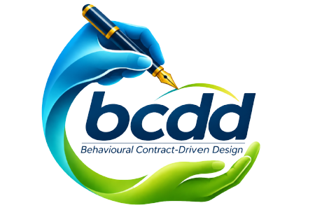
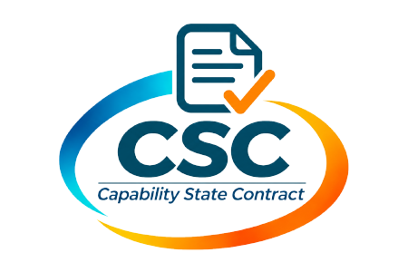

<p align="center">
  <a href="https://bcdd.nolisoft.it/"><picture><source srcset="docs/logos/logo-bcdd-scuro.png" media="(prefers-color-scheme: dark)"></picture></a>
  &nbsp;&nbsp;
  <a href="https://bcdd.nolisoft.it/"><picture><source srcset="docs/logos/logo-csc-scuro.png" media="(prefers-color-scheme: dark)"></picture></a>
</p>

# BCDD — Behavioural Contract-Driven Design

**Site, manual and grammar (English and Italian): <https://bcdd.nolisoft.it/>**

BCDD (Behavioural Contract-Driven Design) is a language for writing the behaviour of a system as contracts, one *capability
state contract* (CSC) per file. This repository holds the source of the two programs that read and help write those files.
This is version **1.0-beta**: the language and the programs work, but they have not had the field use of a final release.

## Why BCDD

- **Not just software.** A CSC describes a system only through its boundaries, that is its interfaces with the outside:
  what can be requested of it and what can be observed from outside. It does not describe how the system is built. The
  same language can therefore describe software, hardware and mixed systems, including complex ones; the manual's real
  case is an audio measurement kit.
- **A formal language for generative models.** The aim is a precise and complete language for communicating with
  generative language models: a description that leaves as little room as possible for interpretation of what is
  required.
- **Closed at every level of detail.** CSCs and entities can be written at different levels of detail, from the whole
  system down to a single part. An entity made of parts that passes `bcdd check` is closed: every boundary that a part
  uses is provided by another part or used by the entity towards the outside, every public boundary is entrusted to a
  part, and every boundary provided is used. It is therefore complete at its level of detail: whoever builds it finds no
  boundary missing. Whether the system can actually be built is not something `bcdd` checks.
- **The language model as an assistant.** `bcdd refine` and the editor's “Complete” button use a language model, through
  Claude Code, to propose questions and lines of the contract. The operator answers, chooses and approves: nothing
  becomes part of the contract without approval (`bcdd ratify`).

## Looking for testers and contributors

BCDD is at version 1.0-beta: the language and the programs work, but they have not yet been tried enough on real cases.
We are looking first for **testers**: people who try BCDD on a system they know (software, hardware or mixed) and report
what they wrote, what was difficult and what the results were. Anyone who wants to go further can also discuss the
language, improve the examples and the documentation, or work on the programs.

Helpful experience includes systems or hardware design, embedded software, testing and verification, technical writing,
and work with generative language models. Collaboration is voluntary.

To take part, introduce yourself in [Discussions](https://github.com/paolonoli/bcdd/discussions): say what interests you
and which contribution you would like to start with. Small, well-defined tasks are listed in the
[issues labelled `good first issue`](https://github.com/paolonoli/bcdd/labels/good%20first%20issue). How to propose
changes is described in [`CONTRIBUTING.md`](CONTRIBUTING.md).

Ready-to-run packages for Linux x86_64 and Windows x86_64 are on the site and in the
[Releases](https://github.com/paolonoli/bcdd/releases) of this repository.

## The programs

- `bcdd`, the command-line tool: `new`, `check`, `refine`, `ratify`. Written in Nim, source in `src/`.
- `bcdd-editor`, a window around `bcdd` for editing CSC files: GTK 3 and WebKit2GTK on Linux, WebView2 on Windows.
  Source in `editor/`.

## Build

You need Nim 2.0 or later and a C compiler. In short:

```sh
nimble build -d:release        # builds ./bcdd
nimble test                    # builds and runs the test suite of bcdd
nimble editor                  # builds ./bcdd-editor
```

The complete steps, with the dependencies and the tested versions, are in [`BUILD_LINUX.md`](BUILD_LINUX.md) and
[`BUILD_WINDOWS.md`](BUILD_WINDOWS.md).

## Use

```sh
bcdd check FILE.csc              # check a CSC file and print the report
bcdd --lang it check FILE.csc    # the same, with messages in Italian
bcdd new Name                    # create Name.csc from a skeleton
```

The messages are in English by default; `--lang it` (before the command) or the variable `BCDD_LANG=it` switches `bcdd`
and `bcdd-editor` to Italian. `bcdd refine` runs a round of questions through a language model and needs the `claude`
command; `check` and `new` do not. `bcdd ratify` records an approved contract line.

The folders `prove/`, `esempi/` and `tests/` hold the test material: small CSC files with the expected report of
`bcdd`, and the test programs that run them.

## Licence

Source code: BSD 3-Clause, see [`LICENSE`](LICENSE). The documentation (the grammar in this repository, the manual and the
grammar on the site) is under CC BY 4.0, see [`LICENSE_DOCS.md`](LICENSE_DOCS.md). Third-party code under `editor/windows/webview` and the notices in `editor/THIRD_PARTY.md` keep their
own licences. The BCDD and CSC logos in `docs/logos/` are Copyright 2026 Noli Paolo, all rights reserved: they are not
covered by the BSD licence.

## Contact

<bcdd@nolisoft.it>
